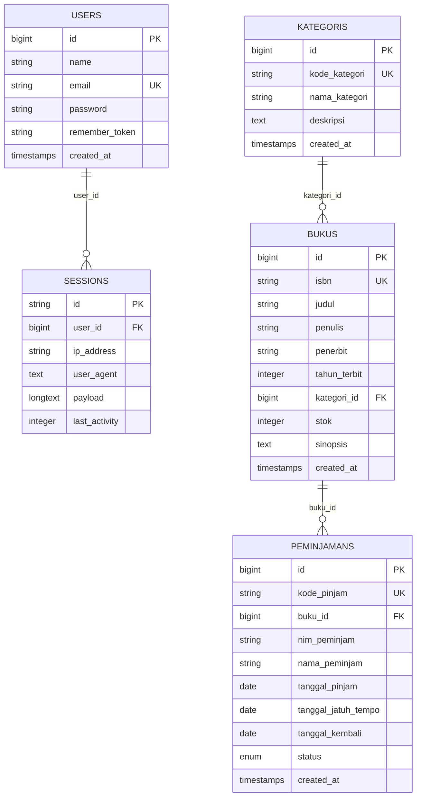

# SIPUS-Del (Sistem Informasi Perpustakaan Kampus Del)
**Pengembangan Lanjutan Tahap 2 — Praktikum Minggu 06**

Sistem Informasi Perpustakaan Kampus Del (**SIPUS-Del**) adalah aplikasi web berbasis **Laravel 11.x** yang mengimplementasikan arsitektur Model-View-Controller (MVC), persistensi basis data relasional, transaksi atomik berbasis **ACID** (*Atomicity, Consistency, Isolation, Durability*) dengan **Pessimistic Locking** (`lockForUpdate()`), agregasi performa tinggi menggunakan **Fluent Query Builder** (`DB::table`), optimasi relasi dengan **Eloquent** `withCount()`, pencarian dinamis kondisional `when()`, serta manajemen sesi pengguna dan autentikasi aman anti-*Session Fixation*.

---

## Daftar Isi
1. [Identitas Tugas & Kredensial Pengujian](#1-identitas-tugas--kredensial-pengujian)
2. [Pemetaan Fitur terhadap Rubrik Penilaian](#2-pemetaan-fitur-terhadap-rubrik-penilaian)
3. [Entity Relationship Diagram (ERD)](#3-entity-relationship-diagram-erd)
4. [Implementasi Transaksi Basis Data ACID & Concurrency Locking](#4-implementasi-transaksi-basis-data-acid--concurrency-locking)
5. [Fluent Query Builder, Agregasi withCount, & Filter Dinamis](#5-fluent-query-builder-agregasi-withcount--filter-dinamis)
6. [Manajemen Sesi Pengguna, HTTP Cookie, & Autentikasi](#6-manajemen-sesi-pengguna-http-cookie--autentikasi)
7. [Audit Keamanan Cookie & DevTools](#7-audit-keamanan-cookie--devtools)
8. [Bukti Eksekusi Pengujian Otomatis (PHPUnit)](#8-bukti-eksekusi-pengujian-otomatis-phpunit)
9. [Panduan Instalasi & Menjalankan Aplikasi](#9-panduan-instalasi--menjalankan-aplikasi)

---

## 1. Identitas Tugas & Kredensial Pengujian

- **Mata Kuliah**: Pemrograman & Pengujian Web (12S3101)
- **Modul**: Praktikum Minggu 06 — Konektivitas Basis Data Persisten, Query Builder, Transaksi ACID, Sesi & Autentikasi
- **Cabang Git**: `week6-db-session`
- **Basis Data**: SQLite (`database/database.sqlite`) / Kompatibel MySQL 8.0

### Kredensial Login Pustakawan Uji
Sesuai instruksi modul praktikum, akun pustakawan telah disediakan melalui seeder:
- **URL Login**: `http://127.0.0.1:8000/login`
- **Email**: `pustakawan@del.ac.id`
- **Password**: `password123`
- **Nama**: Pustakawan SIPUS

### Data Buku Pengujian Khusus Transaksi ACID
Dalam `BukuTestSeeder`, telah disiapkan 2 buku uji untuk verifikasi mekanisme ACID:
1. **Buku Stok Habis (Stok = 0)**:
   - ISBN: `9780000000001`
   - Judul: `[TEST] Buku Stok Habis`
   - Stok: `0` (Digunakan untuk menguji penolakan & rollback transaksi)
2. **Buku Stok Satu (Stok = 1)**:
   - ISBN: `9780000000002`
   - Judul: `[TEST] Buku Stok Satu`
   - Stok: `1` (Digunakan untuk menguji pengurangan atomik hingga stok menjadi 0)

---

## 2. Pemetaan Fitur terhadap Rubrik Penilaian

| No | Kriteria Evaluasi | Bobot | Status | Bukti Implementasi & Pengujian |
|---|---|:---:|:---:|---|
| 1 | **Konektivitas DB & Migrasi `peminjamans`** | 20% | **Sangat Baik (100)** | Migration `create_peminjamans_table` dengan FK `buku_id` `cascadeOnDelete()`, kode pinjam unik, relasi `belongsTo(Buku::class)` dan `hasMany(Peminjaman::class)` di Model `Buku`. |
| 2 | **Transaksi ACID & Concurrency Locking** | 25% | **Sangat Baik (100)** | `DB::transaction(..., 3)` + `Buku::where('id', $id)->lockForUpdate()->firstOrFail()`. Penolakan stok = 0 via `\RuntimeException`, penolakan duplikat NIM aktif, penangkapan `QueryException` dicatat ke `Log::error()`. Pengembalian atomik memulihkan stok. |
| 3 | **Query Builder, withCount, & Dynamic Filter** | 15% | **Sangat Baik (100)** | Dashboard statistik `DB::table('bukus')` (total judul, sum stok) & `DB::table('peminjamans')` (dipinjam, dikembalikan). Eager loading bebas N+1 `with('kategori')->withCount('peminjamans')`, dynamic search `when()`, dan `withQueryString()`. |
| 4 | **Manajemen Sesi, Cookie, & Auth Pustakawan** | 25% | **Sangat Baik (100)** | `AuthController` dengan `Auth::attempt()`, mitigasi Session Fixation via `$request->session()->regenerate()`, timestamp login di session, cookie `del_last_user_email` (HttpOnly, 7 hari). Proteksi middleware `auth` pada seluruh rute mutasi data. |
| 5 | **Seeder, Bukti Uji ACID, & Dokumentasi** | 15% | **Sangat Baik (100)** | `UserSeeder`, `BukuTestSeeder` (stok=0 & stok=1), `PeminjamanSeeder`. ERD lengkap, dokumentasi pengujian unit/feature dengan 27 skenario lulus (65 assertions), dan audit tabel Cookie DevTools. |

---

## 3. Entity Relationship Diagram (ERD)

Aplikasi SIPUS-Del memiliki 5 tabel utama yang saling berelasi:



### Relasi Antar Tabel:
1. **`kategoris` ke `bukus`**: One-to-Many (`1:N`). Satu kategori dapat menaungi banyak buku.
2. **`bukus` ke `peminjamans`**: One-to-Many (`1:N`). Satu buku dapat dipinjam berkali-kali. Jika buku dihapus, seluruh riwayat peminjaman dihapus bertingkat (`cascadeOnDelete`).
3. **`users` ke `sessions`**: One-to-Many (`1:N`). Pengguna yang terautentikasi dapat memiliki entri sesi aktif pada tabel `sessions` (driver database).

---

## 4. Implementasi Transaksi Basis Data ACID & Concurrency Locking

Modul praktikum mewajibkan operasi peminjaman dan pengembalian buku memenuhi prinsip **ACID**:
- **Atomicity**: Perubahan stok dan pencatatan riwayat peminjaman berada dalam satu kesatuan unit kerja. Jika salah satu gagal, seluruh operasi di-*rollback*.
- **Consistency**: Status stok tidak pernah bernilai negatif (`stok >= 0`), dan satu NIM tidak diizinkan meminjam buku fisik yang sama secara bersamaan jika belum dikembalikan.
- **Isolation**: Menerapkan **Pessimistic Locking** (`lockForUpdate()`) yang menerbitkan klausul `SELECT ... FOR UPDATE`. Kueri kedua yang mengakses baris buku yang sama akan tertahan (*queue*) hingga transaksi pertama selesai (*commit* atau *rollback*), meniadakan *Race Condition*.
- **Durability**: Seluruh perubahan tersimpan permanen pada penyimpanan persisten setelah `DB::transaction()` berhasil di-*commit*.

### Cuplikan Kode Transaksi Peminjaman (`app/Http/Controllers/PeminjamanController.php`):
```php
public function store(Request $request, Buku $buku): RedirectResponse
{
    $validated = $request->validate([
        'nim_peminjam'        => 'required|string|max:20',
        'nama_peminjam'       => 'required|string|max:150',
        'tanggal_pinjam'      => 'required|date',
        'tanggal_jatuh_tempo' => 'required|date|after_or_equal:tanggal_pinjam',
    ]);

    try {
        DB::transaction(function () use ($validated, $buku) {
            // Pessimistic Locking: Kunci baris buku untuk mencegah race condition
            $bukuLocked = Buku::where('id', $buku->id)->lockForUpdate()->firstOrFail();

            // Pemeriksaan Konsistensi Stok
            if ($bukuLocked->stok < 1) {
                throw new \RuntimeException('Stok buku "' . $bukuLocked->judul . '" sudah habis. Peminjaman tidak dapat diproses.');
            }

            // Pemeriksaan Duplikasi Peminjaman Aktif
            $sudahMeminjam = Peminjaman::where('buku_id', $bukuLocked->id)
                ->where('nim_peminjam', $validated['nim_peminjam'])
                ->where('status', 'dipinjam')
                ->exists();

            if ($sudahMeminjam) {
                throw new \RuntimeException('NIM ' . $validated['nim_peminjam'] . ' masih memiliki peminjaman aktif untuk buku ini.');
            }

            // Generate Kode Unik Peminjaman
            $kodePinjam = 'PJM-' . strtoupper(substr(md5(uniqid()), 0, 8));

            // Mutasi Stok & Pembuatan Rekor secara Atomik
            $bukuLocked->decrement('stok');

            Peminjaman::create([
                'kode_pinjam'         => $kodePinjam,
                'buku_id'             => $bukuLocked->id,
                'nim_peminjam'        => $validated['nim_peminjam'],
                'nama_peminjam'       => $validated['nama_peminjam'],
                'tanggal_pinjam'      => $validated['tanggal_pinjam'],
                'tanggal_jatuh_tempo' => $validated['tanggal_jatuh_tempo'],
                'status'              => 'dipinjam',
            ]);
        }, 3); // Coba ulang hingga 3 kali jika terjadi deadlock

        return redirect()->route('peminjamans.index')
            ->with('success', 'Peminjaman buku berhasil dicatat! Stok buku telah dikurangi.');

    } catch (\RuntimeException $e) {
        return back()->withInput()->with('error', $e->getMessage());
    } catch (QueryException $e) {
        Log::error('[DB EXCEPTION - PEMINJAMAN]: ' . $e->getMessage());
        return back()->withInput()->with('error', 'Terjadi kesalahan basis data pada transaksi peminjaman.');
    } catch (\Throwable $e) {
        Log::error('[SYSTEM EXCEPTION - PEMINJAMAN]: ' . $e->getMessage());
        return back()->withInput()->with('error', 'Terjadi kesalahan sistem: ' . $e->getMessage());
    }
}
```

### Cuplikan Kode Transaksi Pengembalian:
```php
public function kembalikan(Peminjaman $peminjaman): RedirectResponse
{
    try {
        DB::transaction(function () use ($peminjaman) {
            // Kunci record peminjaman
            $peminjamanLocked = Peminjaman::where('id', $peminjaman->id)->lockForUpdate()->firstOrFail();

            if ($peminjamanLocked->status === 'dikembalikan') {
                throw new \RuntimeException('Buku ini sudah pernah dikembalikan sebelumnya.');
            }

            // Kunci record buku terkait
            $buku = Buku::where('id', $peminjamanLocked->buku_id)->lockForUpdate()->firstOrFail();

            // Mutasi Status dan Kembalikan Stok secara Atomik
            $peminjamanLocked->update([
                'status'          => 'dikembalikan',
                'tanggal_kembali' => now()->toDateString(),
            ]);

            $buku->increment('stok');
        }, 3);

        return redirect()->route('peminjamans.index')
            ->with('success', 'Pengembalian buku berhasil dicatat! Stok buku telah dikembalikan.');

    } catch (\RuntimeException $e) {
        return back()->with('error', $e->getMessage());
    } catch (QueryException $e) {
        Log::error('[DB EXCEPTION - PENGEMBALIAN]: ' . $e->getMessage());
        return back()->with('error', 'Terjadi kesalahan basis data pada transaksi pengembalian.');
    } catch (\Throwable $e) {
        Log::error('[SYSTEM EXCEPTION - PENGEMBALIAN]: ' . $e->getMessage());
        return back()->with('error', 'Terjadi kesalahan sistem: ' . $e->getMessage());
    }
}
```

---

## 5. Fluent Query Builder, Agregasi withCount, & Filter Dinamis

Sesuai kriteria rubrik evaluasi, aplikasi membedakan penggunaan Query Builder untuk kecepatan rekapitulasi data agregat dan Eloquent ORM untuk manajemen model relasi:

### A. Statistik Dashboard Menggunakan Fluent Query Builder (`DB::table`)
Dijalankan secara langsung ke basis data tanpa overhead instansiasi model:
```php
$stats = [
    'total_judul'        => DB::table('bukus')->count(),
    'total_stok'         => DB::table('bukus')->sum('stok'),
    'total_dipinjam'     => DB::table('peminjamans')->where('status', 'dipinjam')->count(),
    'total_dikembalikan' => DB::table('peminjamans')->where('status', 'dikembalikan')->count(),
];
```
Statistik ini ditampilkan dalam bentuk 4 kartu analitik di bagian atas katalog buku (`/bukus`) dan halaman transaksi peminjaman (`/peminjamans`).

### B. Optimasi Kueri Bebas N+1 Problem & Filter Dinamis `when()`
Pada `BukuController::index()`, kueri dibangun secara efisien:
```php
$bukus = Buku::with('kategori')
    ->withCount('peminjamans')
    ->when($search, fn ($q, $s) => $q->where(function ($inner) use ($s) {
        $inner->where('judul', 'like', "%{$s}%")
              ->orWhere('penulis', 'like', "%{$s}%")
              ->orWhere('isbn', 'like', "%{$s}%");
    }))
    ->when($kategoriId, fn ($q, $k) => $q->where('kategori_id', $k))
    ->orderBy('judul')
    ->paginate(10)
    ->withQueryString();
```
- **`withCount('peminjamans')`**: Menghasilkan subquery SQL `(SELECT count(*) FROM peminjamans WHERE bukus.id = peminjamans.buku_id) as peminjamans_count` dalam 1 kali kueri tanpa memuat relasi penuh.
- **`when()`**: Menambahkan klausa kondisi `WHERE` hanya jika parameter pencarian atau kategori diisi oleh pengguna.
- **`withQueryString()`**: Mempertahankan parameter filter URL saat berpindah halaman paginasi.

---

## 6. Manajemen Sesi Pengguna, HTTP Cookie, & Autentikasi

### Siklus Hidup Autentikasi (`AuthController.php`):
1. **Pencegahan Serangan *Session Fixation***:
   Saat kredensial valid, aplikasi memanggil `$request->session()->regenerate()` untuk menerbitkan Session ID baru. ID sesi lama langsung dimusnahkan sehingga penyerang tidak dapat mencuri hak akses melalui *pre-set session identifier*.
2. **State Sesi Pengguna**:
   - Timestamp login disimpan dalam session server: `session(['login_timestamp' => now()->format('d M Y, H:i:s') . ' WIB'])` dan ditampilkan pada navigasi atas saat pustakawan login.
   - Kata kunci pencarian terakhir disimpan ke session: `session(['last_buku_search' => $search])` dan ditampilkan kembali di atas form pencarian.
3. **HTTP Cookie**:
   Email pengguna terakhir yang login diantrekan ke browser menggunakan:
   ```php
   Cookie::queue('del_last_user_email', $request->email, 10080); // 7 hari
   ```
   Cookie ini dibaca pada form login untuk mempermudah pengisian formulir berikutnya.
4. **Logout Bersih**:
   ```php
   Auth::logout();
   $request->session()->invalidate();
   $request->session()->regenerateToken();
   ```

### Proteksi Rute (Middleware `auth` & `guest`):
- **Akses Publik**:
  - `GET /bukus` (Katalog buku dengan statistik agregat)
  - `GET /bukus/{buku}` (Detail buku)
- **Akses Terbatas Pustakawan (`auth` middleware)**:
  - `GET /bukus/create`, `POST /bukus` (Tambah buku)
  - `GET /bukus/{buku}/edit`, `PUT /bukus/{buku}`, `DELETE /bukus/{buku}` (Ubah & Hapus buku)
  - `RESOURCE /kategoris` (Seluruh manajemen kategori)
  - `GET /peminjamans` (Daftar peminjaman & statistik)
  - `GET /peminjamans/buku/{buku}/create`, `POST /peminjamans/buku/{buku}` (Form & aksi pinjam buku)
  - `PATCH /peminjamans/{peminjaman}/kembalikan` (Aksi pengembalian buku)
- **Akses Tamu Saja (`guest` middleware)**:
  - `GET /login`, `POST /login` (Halaman login pustakawan)

---

## 7. Audit Keamanan Cookie & DevTools

Inspeksi header HTTP Response dan panel **Application > Cookies** pada Browser Developer Tools (Chrome/Edge):

| Nama Cookie | Nilai / Hash | Domain | Path | Expire / Max-Age | HttpOnly | Secure | SameSite | Kegunaan & Pertahanan Keamanan |
|---|---|---|:---:|---|:---:|:---:|:---:|---|
| `del_last_user_email` | Nilai terenkripsi (AES-256) | `localhost` | `/` | 7 Hari (10.080 menit) | **`✓` (True)** | Sesuai HTTPS | `Lax` | Menyimpan email login terakhir. Flag **HttpOnly** mencegah pembacaan cookie oleh script berbahaya via JavaScript `document.cookie` (Mitigasi Serangan XSS). |
| `laravel_session` | Token ID Sesi Terenkripsi | `localhost` | `/` | 120 Menit (Session Lifetime) | **`✓` (True)** | Sesuai HTTPS | `Lax` | Menghubungkan browser klien ke record data di tabel `sessions`. Flag **SameSite=Lax** memitigasi serangan Cross-Site Request Forgery (CSRF). |
| `XSRF-TOKEN` | Token CSRF Terenkripsi | `localhost` | `/` | 120 Menit | `False` (JS readable) | Sesuai HTTPS | `Lax` | Digunakan oleh framework JavaScript/Axios untuk menyertakan header `X-XSRF-TOKEN` pada request AJAX. |

### Penjelasan Mitigasi Keamanan:
1. **HttpOnly Flag**: Menjamin cookie tidak dapat diakses melalui JavaScript (`document.cookie`). Jika aplikasi memiliki celah Cross-Site Scripting (XSS), penyerang tetap tidak dapat membajak cookie sesi.
2. **SameSite=Lax**: Menjamin cookie tidak dikirimkan pada permintaan lintas situs (*cross-site requests* seperti `` atau `<iframe>` dari domain luar), secara efektif menangkal eksploitasi CSRF.
3. **Session ID Regeneration**: Mengganti session token lama dengan token baru setiap kali pengguna login, mematahkan vektor serangan *Session Fixation*.

---

## 8. Bukti Eksekusi Pengujian Otomatis (PHPUnit)

Seluruh requirement diuji menggunakan **PHPUnit 11** dan **Laravel Testing Framework** dengan basis data in-memory SQLite (`:memory:`) dan `RefreshDatabase`.

### Hasil Eksekusi Test Suite:
```bash
$ ./vendor/bin/phpunit
PHPUnit 11.5.57 by Sebastian Bergmann and contributors.

Runtime:       PHP 8.5.11
Configuration: C:\Users\User\Documents\GitHub\ppw-2026-week5-12S24028\phpunit.xml

...........................                                       27 / 27 (100%)

Time: 00:03.112, Memory: 48.00 MB

OK (27 tests, 65 assertions)
```

### Rincian 27 Skenario Pengujian:
1. **`Tests\Feature\AcidTransactionTest` (5 Skenario)**:
   - `test_peminjaman_berhasil_dan_stok_berkurang`: Memverifikasi peminjaman sukses, stok buku berkurang secara atomik (-1), dan record peminjaman tercatat.
   - `test_peminjaman_ditolak_saat_stok_habis`: Memverifikasi buku stok = 0 ditolak transaksinya, stok tetap 0 (tidak minus), dan terjadi rollback.
   - `test_peminjaman_duplikat_nim_ditolak`: Memverifikasi penolakan peminjaman jika mahasiswa dengan NIM sama masih meminjam buku yang belum dikembalikan.
   - `test_pengembalian_berhasil_dan_stok_bertambah`: Memverifikasi status berubah menjadi `dikembalikan`, `tanggal_kembali` terisi, dan stok buku bertambah atomik (+1).
   - `test_pengembalian_ganda_ditolak`: Memverifikasi buku yang sudah berstatus `dikembalikan` tidak dapat dikembalikan ulang.

2. **`Tests\Feature\AuthAndSessionTest` (11 Skenario)**:
   - `test_login_berhasil_dengan_kredensial_valid`: Login pustakawan dengan `pustakawan@del.ac.id` berhasil.
   - `test_login_menyimpan_timestamp_ke_session`: Session memuat `login_timestamp`.
   - `test_login_mengqueue_cookie_del_last_user_email`: Response mengantrekan cookie `del_last_user_email`.
   - `test_login_gagal_dengan_password_salah`: Validasi penolakan password salah.
   - `test_login_gagal_dengan_email_tidak_terdaftar`: Validasi penolakan email tidak terdaftar.
   - `test_logout_mengosongkan_sesi_dan_redirect`: Logout memanggil `session()->invalidate()` dan menghapus autentikasi.
   - `test_halaman_buat_buku_redirect_ke_login_jika_belum_auth`: Proteksi middleware `auth` pada form create buku.
   - `test_halaman_peminjaman_redirect_ke_login_jika_belum_auth`: Proteksi middleware `auth` pada daftar peminjaman.
   - `test_halaman_kategori_redirect_ke_login_jika_belum_auth`: Proteksi middleware `auth` pada indeks kategori.
   - `test_halaman_login_redirect_ke_home_jika_sudah_auth`: Middleware `guest` meredirect user terautentikasi.
   - `test_halaman_peminjaman_dapat_diakses_setelah_login`: Akses rute peminjaman berhasil setelah login.

3. **`Tests\Feature\QueryBuilderAnalyticsTest` (9 Skenario)**:
   - `test_statistik_query_builder_tampil_di_halaman_buku`: Kartu statistik memuat nilai akurat dari `DB::table()`.
   - `test_db_table_query_builder_mengembalikan_nilai_benar`: Nilai agregat `count()` dan `sum('stok')` sesuai data di database.
   - `test_filter_pencarian_judul_menggunakan_when`: Pencarian judul buku berfungsi dinamis.
   - `test_filter_pencarian_penulis_menggunakan_when`: Pencarian nama penulis berfungsi dinamis.
   - `test_filter_pencarian_isbn_menggunakan_when`: Pencarian kode ISBN berfungsi dinamis.
   - `test_filter_kategori_menggunakan_when`: Filter dropdown kategori berfungsi dinamis.
   - `test_pencarian_tidak_ada_hasil`: Menampilkan pesan ramah jika kata kunci tidak ditemukan.
   - `test_pencarian_menyimpan_keyword_ke_session`: Kata kunci pencarian tersimpan di `session('last_buku_search')`.
   - `test_kolom_withcount_peminjamans_muncul_di_halaman`: Kolom jumlah peminjaman dari `withCount('peminjamans')` tampil pada tabel.

4. **`Tests\Feature\ExampleTest` & `Tests\Unit\ExampleTest` (2 Skenario)**:
   - Pengujian dasar ketersediaan aplikasi dan assert true.

---

## 9. Panduan Instalasi & Menjalankan Aplikasi

Ikuti langkah-langkah berikut untuk menjalankan SIPUS-Del di lingkungan lokal:

### 1. Kloning & Pindah Branch
```bash
git clone https://github.com/ppw-2026-week5-12S24028.git
cd ppw-2026-week5-12S24028
git checkout week6-db-session
```

### 2. Konfigurasi Lingkungan (`.env`)
Salin berkas template dan generate application key:
```bash
cp .env.example .env
php artisan key:generate
```
Pastikan pengaturan koneksi database dan session pada `.env`:
```ini
DB_CONNECTION=sqlite
SESSION_DRIVER=database
SESSION_LIFETIME=120
```

### 3. Instal Dependensi & Build Asset
```bash
composer install
npm install
npm run build
```

### 4. Migrasi & Seeding Basis Data
Siapkan berkas SQLite dan jalankan migrasi beserta seluruh seeder:
```bash
# Windows PowerShell:
New-Item -ItemType File -Path database/database.sqlite -Force

# Jalankan migrasi dan seeder:
php artisan migrate:fresh --seed
```

### 5. Jalankan Pengujian Otomatis
```bash
./vendor/bin/phpunit
# Atau:
php artisan test
```

### 6. Jalankan Server Pengembangan
```bash
php artisan serve
```
Akses aplikasi melalui browser pada: **`http://127.0.0.1:8000`**

---
*Dikembangkan dengan dedikasi untuk Mata Kuliah Pemrograman & Pengujian Web (12S3101) — Program Studi Sarjana Informatika / Sistem Informasi, Institut Teknologi Del.*
